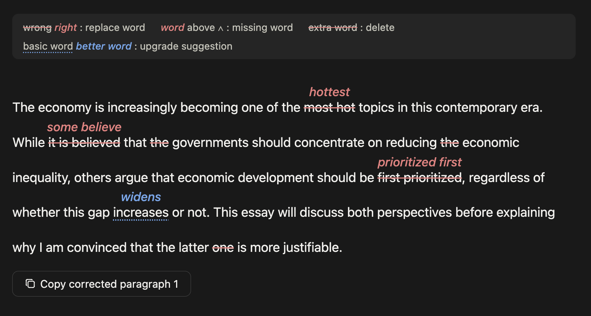

# coach-writing-ielts

Corrects an IELTS Writing essay the way an IELTS teacher would. On top of grammar and spelling, it replaces everyday words with academic ones, rewrites awkward phrases and clumsy structures, and crosses out examples that overlap or don't follow logically. All changes are marked inside the essay, with a button to copy the clean version. Below the essay you get a band estimate for each of the four IELTS criteria.

For everyday writing (emails, messages), use [`coach-writing`](../coach-writing) instead: it fixes errors and leaves your wording alone.

## How it looks

Red marks are required fixes. Where two wordings are equally good, both are shown separated by " / ". Blue marks are optional.

## Use it

**Type `/coach-writing-ielts` followed by your essay to get it corrected.**

You can also send Claude your IELTS essay and ask it to check or correct it. Include the task prompt if you have it, so Task Response can be judged properly. For example:

> Check my IELTS Task 2 essay. Prompt: Some people think governments should focus on reducing economic inequality, while others think economic growth matters more. Discuss both views and give your opinion.
>
> The economy is increasingly becoming one of the most hot topics...

You can write the request in your own language. Claude replies in that language and keeps the corrected essay in English.

The band is an estimate, not an official score.

## Requires coach-writing

This skill reads the correction widget from [`../coach-writing/reference/widget.md`](../coach-writing/reference/widget.md). Installing the `coach-me` plugin gives you both skills. Without `coach-writing` next to it, this skill shows corrections as plain markdown instead of the widget.
