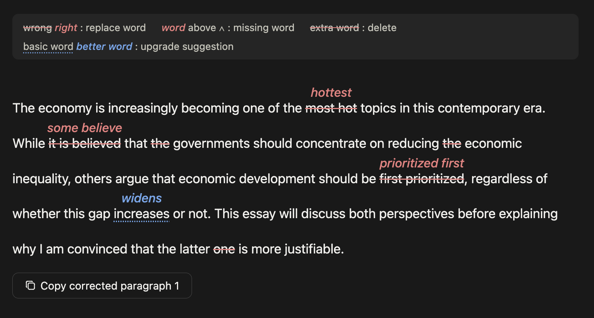

# coach-writing

Corrects your English writing like a teacher with a red pen: wrong words are struck through with the fix written above, missing words get a ∧ caret, unclear sentences are crossed out and rewritten. Optional blue suggestions upgrade basic vocabulary, sentence structure, and cohesion. Includes a button to copy the clean version.

## How it looks

Red marks are errors to fix. Blue marks are optional upgrades.

## Use it

**Type `/coach-writing` followed by your text to get it corrected.**

You can also send Claude some English text and ask it to check or correct it. For example:

> Check my writing: I want go to the supermarket because my sister like fruit.

You can write the request in your own language. Claude replies in that language and keeps the corrected text in English.
